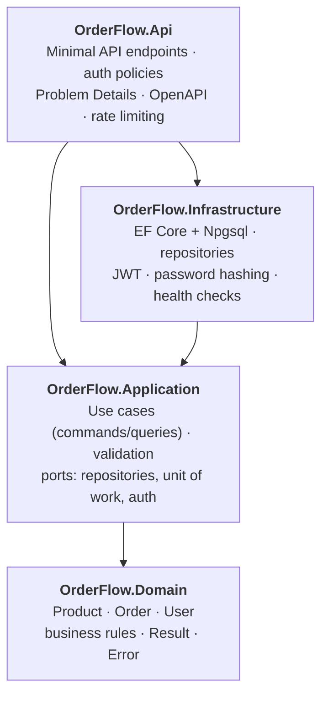
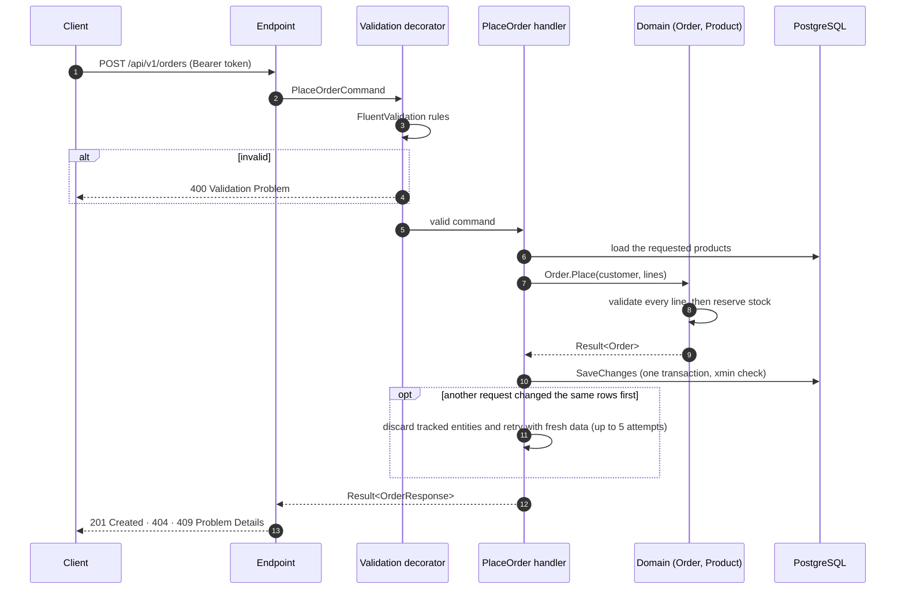
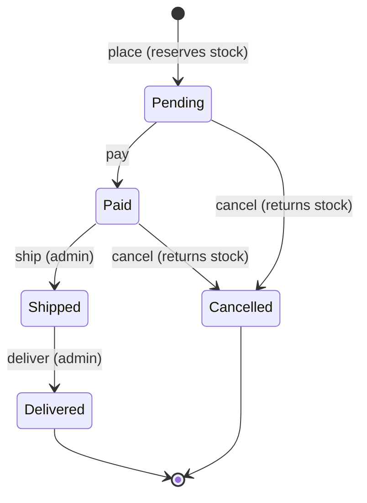

# OrderFlow

[](https://github.com/YOUR_GITHUB_USER/OrderFlow/actions/workflows/ci.yml)


[](LICENSE)

**An order management REST API built with .NET 10, Clean Architecture and PostgreSQL**, written the way
production code should be: a rich domain model, explicit error handling, real concurrency control, and
integration tests that run against a real database.

> 🇧🇷 [Leia em português](README.pt-BR.md)

---

## Highlights

| | |
|---|---|
| 🏛️ **Clean Architecture** | Four projects; the dependency rule is enforced by project references, not by convention. |
| 🧠 **Rich domain model** | Aggregates protect their own invariants: stock never goes negative, orders follow a strict state machine, and placing an order is all-or-nothing. |
| ✉️ **CQRS without MediatR** | Tiny handler interfaces resolved straight from DI. Validation runs in a decorator, wired once at startup. No per-request reflection and nothing to license. |
| 🚦 **Result pattern + Problem Details** | Expected failures are values, not exceptions. Every error is an [RFC 9457](https://www.rfc-editor.org/rfc/rfc9457) response with a stable, machine-readable `code` and a `traceId`. |
| 🔒 **Optimistic concurrency** | PostgreSQL's `xmin` column works as a row version. A command that loses a race is retried with fresh data, so concurrent buyers of a well-stocked product all succeed, and in a race for the last unit exactly one wins. Integration tests cover both cases. |
| 🔐 **Security** | JWT bearer auth with roles; resource-based authorization (another customer's order returns `404`, so its existence is never revealed); PBKDF2 password hashing; rate-limited auth endpoints; a non-root container. |
| 🔭 **Observability** | Serilog structured logging, request logging, and separate liveness and readiness health checks. |
| 🧪 **Tested at every layer** | 159 tests: domain unit tests, application tests with NSubstitute, and API tests using `WebApplicationFactory` with **Testcontainers PostgreSQL**. |
| ⚙️ **Developer experience** | Docker Compose, GitHub Actions CI, Central Package Management, warnings as errors, Dependabot, an OpenAPI document with a Scalar UI, and a ready-made `.http` walkthrough. |

## Architecture



* **Domain** has no dependencies at all. Entities expose behaviour (`order.Ship()`, `product.Reserve()`)
  instead of setters, and return a `Result` when a business rule is broken.
* **Application** contains one vertical slice per use case: command/query, validator and handler live side by
  side (e.g. [`PlaceOrder.cs`](src/OrderFlow.Application/Features/Orders/PlaceOrder.cs)). It defines *ports*
  (`IOrderRepository`, `IUnitOfWork`, `ITokenProvider`...) and knows nothing about EF Core or HTTP. Every handler is
  wrapped in decorators: commands get validation and a bounded retry on concurrency conflicts, and queries get validation.
* **Infrastructure** implements those ports with EF Core, PostgreSQL and JWT. It also translates provider
  errors (concurrency, unique violations) into application exceptions.
* **Api** is a thin HTTP layer: it maps requests to commands and `Result`s to status codes.

### Placing an order



### Order lifecycle



## Tech stack

| Concern | Choice |
|---|---|
| Runtime | .NET 10 (LTS), C# 14, ASP.NET Core Minimal APIs |
| Persistence | EF Core 10, Npgsql, PostgreSQL 17, snake_case naming, migrations |
| Validation | FluentValidation |
| Auth | JWT bearer tokens, role-based policies, ASP.NET Core Identity password hasher |
| API docs | `Microsoft.AspNetCore.OpenApi` and [Scalar](https://scalar.com) |
| Logging | Serilog |
| Tests | xUnit v3 on Microsoft.Testing.Platform, Shouldly, NSubstitute, Testcontainers, `WebApplicationFactory` |
| Delivery | Docker (multi-stage, non-root), Docker Compose, GitHub Actions, Dependabot |

## Getting started

### Option 1: everything in Docker (recommended)

Requires only [Docker](https://www.docker.com/).

```bash
docker compose up --build
```

Open **http://localhost:8080/scalar** for the interactive API reference.

### Option 2: run the API with the .NET SDK

Requires the [.NET 10 SDK](https://dotnet.microsoft.com/download) and Docker for the database.

```bash
docker compose up -d postgres
dotnet run --project src/OrderFlow.Api
```

The API listens on **http://localhost:5080** (Scalar at `/scalar`).

In the `Development` environment, the database is migrated automatically and seeded with sample products and an
administrator account:

| E-mail | Password |
|---|---|
| `admin@orderflow.dev` | `Admin@12345` |

> These credentials and the JWT signing key in `appsettings.Development.json` are for local use only.
> In any other environment, no secret is configured and the app refuses to start until one is provided.

### Try it

Open [`src/OrderFlow.Api/OrderFlow.Api.http`](src/OrderFlow.Api/OrderFlow.Api.http) in Visual Studio, Rider or VS Code
(REST Client). It runs the whole flow: sign in as admin, create a product, register a customer, place an order, then pay,
ship and deliver it. With curl:

```bash
# Sign in and keep the token
TOKEN=$(curl -s -X POST http://localhost:8080/api/v1/auth/login \
  -H "Content-Type: application/json" \
  -d '{"email":"admin@orderflow.dev","password":"Admin@12345"}' | jq -r .accessToken)

# Browse the catalog (anonymous)
curl -s "http://localhost:8080/api/v1/products?search=keyboard"

# Create a product (admin)
curl -s -X POST http://localhost:8080/api/v1/products \
  -H "Authorization: Bearer $TOKEN" -H "Content-Type: application/json" \
  -d '{"sku":"MIC-USB-01","name":"USB Microphone","price":399.90,"initialStock":20}'
```

## API overview

All routes are under `/api/v1`. 🔓 = anonymous · 👤 = any signed-in user · 🛡️ = administrator.

| Method | Route | Access | Description |
|---|---|---|---|
| `POST` | `/auth/register` | 🔓 | Create a customer account (returns a token) |
| `POST` | `/auth/login` | 🔓 | Exchange credentials for a token |
| `GET` | `/auth/me` | 👤 | Current user profile |
| `GET` | `/products?search=&page=&pageSize=&includeInactive=` | 🔓 | Search the catalog (paginated) |
| `GET` | `/products/{id}` | 🔓 | Product details |
| `POST` | `/products` | 🛡️ | Create a product |
| `PUT` | `/products/{id}` | 🛡️ | Update name, description and price |
| `POST` | `/products/{id}/restock` | 🛡️ | Add units to stock |
| `DELETE` | `/products/{id}` | 🛡️ | Deactivate (soft delete) |
| `POST` | `/orders` | 👤 | Place an order |
| `GET` | `/orders?status=&page=&pageSize=` | 👤 | My orders (admins see all) |
| `GET` | `/orders/{id}` | 👤 | Order details |
| `POST` | `/orders/{id}/pay` | 👤 | Simulate payment |
| `POST` | `/orders/{id}/cancel` | 👤 | Cancel and return stock |
| `POST` | `/orders/{id}/ship` | 🛡️ | Mark as shipped |
| `POST` | `/orders/{id}/deliver` | 🛡️ | Mark as delivered |

Health checks: `GET /health/live` (process is up) and `GET /health/ready` (database reachable).

### Error contract

Every error follows RFC 9457 and includes a stable `code` clients can depend on. Business errors use domain codes
(`Products.InsufficientStock`, `Orders.InvalidStatusTransition`...). Framework and infrastructure errors use `General.*`
codes (`General.Unauthorized`, `General.TooManyRequests`, `General.ConcurrencyConflict`...):

```json
{
  "type": "https://tools.ietf.org/html/rfc9110#section-15.5.10",
  "title": "Conflict",
  "status": 409,
  "detail": "Product '0193…' has 1 unit(s) in stock, but 2 were requested.",
  "instance": "/api/v1/orders",
  "code": "Products.InsufficientStock",
  "traceId": "00-4bf92f3577b34da6a3ce929d0e0e4736-00f067aa0ba902b7-00"
}
```

Validation failures return `400` with an `errors` object keyed by JSON path (`items[0].quantity`).

## Tests

```bash
dotnet test
```

| Project | What it covers |
|---|---|
| `OrderFlow.Domain.UnitTests` | Invariants, state transitions, all-or-nothing stock reservation |
| `OrderFlow.Application.UnitTests` | Handlers with NSubstitute, validators, the validation and retry decorators, and a guard that every handler is registered and decorated |
| `OrderFlow.Api.IntegrationTests` | The real API in memory against PostgreSQL in Docker: auth, invalid JWTs, rate limiting, authorization, validation, the order lifecycle, and concurrency races |

Integration tests need a running Docker engine. Code coverage:

```bash
dotnet test --coverage --coverage-output-format cobertura
```

## Project structure

```text
├── src
│   ├── OrderFlow.Domain            # Entities, business rules, Result/Error
│   ├── OrderFlow.Application       # Use cases (Features/*), validation, ports
│   ├── OrderFlow.Infrastructure    # EF Core, migrations, repositories, JWT
│   └── OrderFlow.Api               # Endpoints, error mapping, OpenAPI, Program.cs
├── tests
│   ├── OrderFlow.Domain.UnitTests
│   ├── OrderFlow.Application.UnitTests
│   └── OrderFlow.Api.IntegrationTests
├── .github                         # CI workflow and Dependabot
├── Directory.Build.props           # Shared compiler settings (nullable, warnings as errors)
├── Directory.Packages.props        # Central Package Management
├── Dockerfile · docker-compose.yml
└── OrderFlow.slnx
```

## Design decisions

* **Errors are values.** Business failures (`InsufficientStock`, `InvalidStatusTransition`...) are returned as
  `Result` objects and mapped to HTTP in one place. Exceptions are reserved for truly exceptional situations.
* **No MediatR.** MediatR moved to a commercial license, and the project only needs dispatch plus one cross-cutting
  behaviour. Three small interfaces and a decorator do the same job with less indirection.
* **Repositories instead of leaking `DbContext`.** Use cases depend on ports. That keeps them unit-testable with
  plain substitutes, and keeps EF Core inside Infrastructure.
* **`xmin` for concurrency, with retries.** PostgreSQL already maintains the column, so there's no extra state to keep
  in sync. It is mapped as a shadow property, which keeps the domain persistence-ignorant. Handlers always read before
  they write, so a decorator can safely re-run a command that lost a race, after discarding the stale entities.
* **Order items snapshot SKU, name and price.** Changing the catalog never rewrites what a customer bought.
* **UUIDv7 identifiers.** They can be generated in the application, yet they are time-ordered, so B-tree indexes stay compact.
* **Not found over forbidden.** Customers asking for someone else's order get `404`, so order IDs can't be probed.
* **Migrations on startup are a development convenience.** For production, run an EF Core migration bundle as a
  deployment step.

## Configuration

Settings use the standard ASP.NET Core configuration, so any key can come from an environment variable
(`__` separates sections).

| Key | Description |
|---|---|
| `ConnectionStrings__Database` | PostgreSQL connection string |
| `Jwt__SecretKey` | HMAC signing key, at least 32 characters (**required**) |
| `Jwt__Issuer` / `Jwt__Audience` / `Jwt__ExpirationMinutes` | Token settings |
| `Database__ApplyMigrationsOnStartup` | Apply EF Core migrations at startup |
| `Database__SeedSampleProducts` | Seed demo products when the catalog is empty |
| `Database__AdminEmail` / `Database__AdminPassword` | Create an administrator if missing |
| `RateLimiting__Auth__PermitLimit` / `RateLimiting__Auth__WindowSeconds` | Per-IP limit for login and registration |
| `ForwardedHeaders__Enabled` | Read the client IP from `X-Forwarded-For` when running behind a reverse proxy |
| `ForwardedHeaders__KnownProxies__0` / `ForwardedHeaders__KnownNetworks__0` | Trusted proxy IPs / CIDR ranges (only these may set forwarded headers) |

## Roadmap

- [ ] Domain events with a transactional outbox (e.g. notify on `OrderPaid`)
- [ ] Refresh tokens and token revocation
- [ ] Idempotency keys for `POST /orders`
- [ ] OpenTelemetry traces and metrics, and a .NET Aspire AppHost
- [ ] Output caching for the public catalog

## License

Distributed under the [MIT License](LICENSE).
