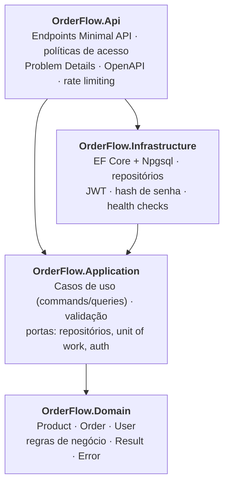
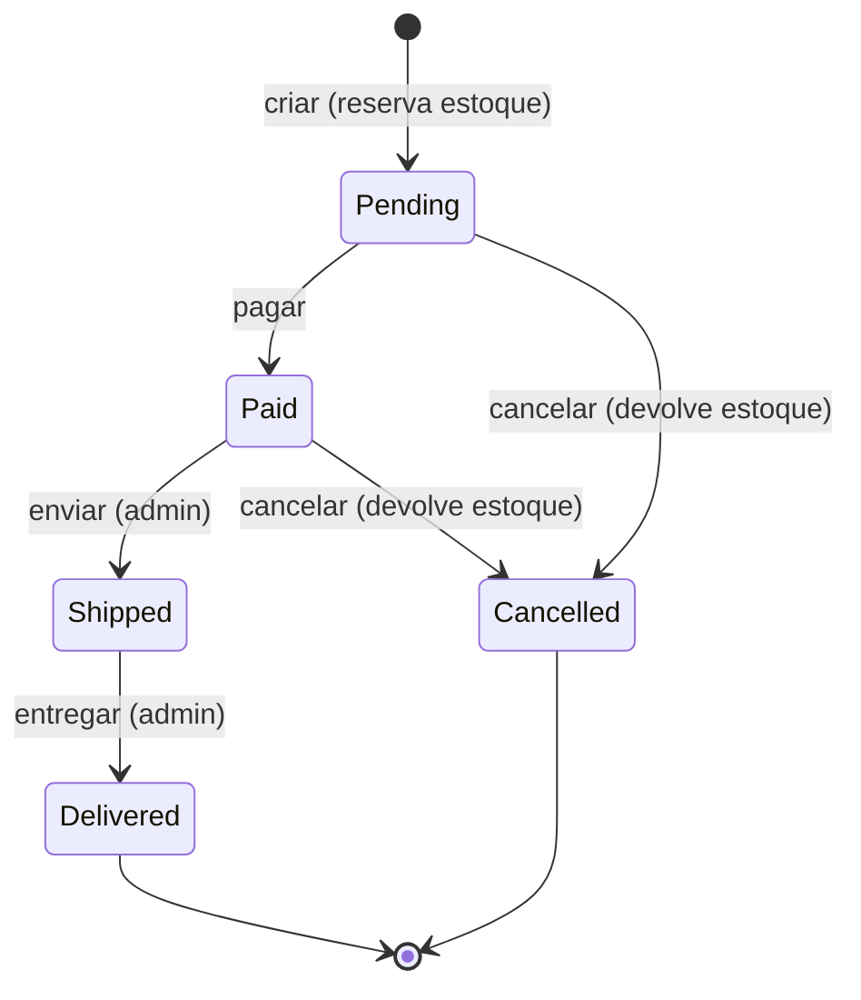

# OrderFlow

[](https://github.com/YOUR_GITHUB_USER/OrderFlow/actions/workflows/ci.yml)


[](LICENSE)

**API REST de gestão de pedidos em .NET 10, com Clean Architecture e PostgreSQL**, escrita como código de
produção deve ser: domínio rico, tratamento de erros explícito, controle de concorrência de verdade e testes de
integração rodando contra um banco real.

> 🇺🇸 [Read in English](README.md)

---

## Destaques

| | |
|---|---|
| 🏛️ **Clean Architecture** | Quatro projetos. A regra de dependência é garantida pelas referências entre projetos, não por convenção. |
| 🧠 **Domínio rico** | Os agregados protegem as próprias invariantes: o estoque nunca fica negativo, o pedido segue uma máquina de estados rígida e a criação do pedido é tudo ou nada. |
| ✉️ **CQRS sem MediatR** | Interfaces de handler mínimas, resolvidas direto do container de DI. A validação roda num decorator registrado uma única vez na inicialização. Sem reflection por requisição e sem licença comercial. |
| 🚦 **Result pattern + Problem Details** | Falhas esperadas são valores, não exceções. Todo erro é uma resposta [RFC 9457](https://www.rfc-editor.org/rfc/rfc9457) com um `code` estável e legível por máquina, mais um `traceId`. |
| 🔒 **Concorrência otimista** | A coluna `xmin` do PostgreSQL funciona como versão da linha. Um comando que perde a disputa é repetido com dados novos, então compradores simultâneos de um produto com estoque sobrando são todos atendidos, e na disputa pela última unidade só um leva. Testes de integração cobrem os dois casos. |
| 🔐 **Segurança** | JWT com perfis; autorização por recurso (pedido de outro cliente retorna `404`, então a existência dele nunca vaza); hash de senha PBKDF2; rate limit nos endpoints de autenticação; container sem root. |
| 🔭 **Observabilidade** | Logs estruturados com Serilog, log de requisições e health checks separados de liveness e readiness. |
| 🧪 **Testes em todas as camadas** | 159 testes: unitários de domínio, de aplicação com NSubstitute, e de API com `WebApplicationFactory` + **Testcontainers PostgreSQL**. |
| ⚙️ **Experiência de desenvolvimento** | Docker Compose, CI no GitHub Actions, Central Package Management, warnings tratados como erro, Dependabot, documento OpenAPI com interface Scalar e um arquivo `.http` pronto. |

## Arquitetura



* **Domain** não depende de nada. As entidades expõem comportamento (`order.Ship()`, `product.Reserve()`) em
  vez de setters, e devolvem um `Result` quando uma regra de negócio é violada.
* **Application** tem uma fatia vertical por caso de uso: command/query, validador e handler ficam juntos
  (ex.: [`PlaceOrder.cs`](src/OrderFlow.Application/Features/Orders/PlaceOrder.cs)). Define as *portas*
  (`IOrderRepository`, `IUnitOfWork`, `ITokenProvider`...) e não conhece EF Core nem HTTP. Todo handler é envolvido por
  decorators: commands ganham validação e um retry limitado em conflitos de concorrência, e queries ganham validação.
* **Infrastructure** implementa essas portas com EF Core, PostgreSQL e JWT, e traduz erros do provedor
  (concorrência, violação de unicidade) em exceções da aplicação.
* **Api** é uma camada HTTP fina: transforma requisições em commands e `Result`s em status HTTP.

### Ciclo de vida do pedido



## Stack

| Tema | Escolha |
|---|---|
| Runtime | .NET 10 (LTS), C# 14, ASP.NET Core Minimal APIs |
| Persistência | EF Core 10, Npgsql, PostgreSQL 17, nomes em snake_case, migrations |
| Validação | FluentValidation |
| Autenticação | JWT bearer, políticas por perfil, password hasher do ASP.NET Core Identity |
| Documentação da API | `Microsoft.AspNetCore.OpenApi` e [Scalar](https://scalar.com) |
| Logs | Serilog |
| Testes | xUnit v3 sobre Microsoft.Testing.Platform, Shouldly, NSubstitute, Testcontainers, `WebApplicationFactory` |
| Entrega | Docker (multi-stage, sem root), Docker Compose, GitHub Actions, Dependabot |

## Como rodar

### Opção 1: tudo no Docker (recomendado)

Só precisa do [Docker](https://www.docker.com/).

```bash
docker compose up --build
```

Abra **http://localhost:8080/scalar** para a documentação interativa.

### Opção 2: API com o SDK do .NET

Precisa do [SDK do .NET 10](https://dotnet.microsoft.com/download) e do Docker para o banco.

```bash
docker compose up -d postgres
dotnet run --project src/OrderFlow.Api
```

A API sobe em **http://localhost:5080** (Scalar em `/scalar`).

No ambiente `Development`, o banco é migrado automaticamente e recebe produtos de exemplo e uma conta de
administrador:

| E-mail | Senha |
|---|---|
| `admin@orderflow.dev` | `Admin@12345` |

> Essas credenciais e a chave JWT do `appsettings.Development.json` são só para uso local. Em qualquer outro
> ambiente nenhum segredo vem configurado, e a aplicação se recusa a subir até que um seja informado.

### Testando na prática

Abra o [`src/OrderFlow.Api/OrderFlow.Api.http`](src/OrderFlow.Api/OrderFlow.Api.http) no Visual Studio, Rider ou VS Code
(REST Client). Ele executa o fluxo completo: login como admin, criar produto, cadastrar cliente, fazer pedido, depois
pagar, enviar e entregar.

## Endpoints

Todas as rotas ficam sob `/api/v1`. 🔓 = anônimo · 👤 = qualquer usuário logado · 🛡️ = administrador.

| Método | Rota | Acesso | Descrição |
|---|---|---|---|
| `POST` | `/auth/register` | 🔓 | Cria conta de cliente (retorna token) |
| `POST` | `/auth/login` | 🔓 | Troca credenciais por token |
| `GET` | `/auth/me` | 👤 | Perfil do usuário atual |
| `GET` | `/products?search=&page=&pageSize=&includeInactive=` | 🔓 | Busca no catálogo (paginada) |
| `GET` | `/products/{id}` | 🔓 | Detalhe do produto |
| `POST` | `/products` | 🛡️ | Cria produto |
| `PUT` | `/products/{id}` | 🛡️ | Atualiza nome, descrição e preço |
| `POST` | `/products/{id}/restock` | 🛡️ | Repõe estoque |
| `DELETE` | `/products/{id}` | 🛡️ | Desativa (soft delete) |
| `POST` | `/orders` | 👤 | Cria pedido |
| `GET` | `/orders?status=&page=&pageSize=` | 👤 | Meus pedidos (admin vê todos) |
| `GET` | `/orders/{id}` | 👤 | Detalhe do pedido |
| `POST` | `/orders/{id}/pay` | 👤 | Simula pagamento |
| `POST` | `/orders/{id}/cancel` | 👤 | Cancela e devolve o estoque |
| `POST` | `/orders/{id}/ship` | 🛡️ | Marca como enviado |
| `POST` | `/orders/{id}/deliver` | 🛡️ | Marca como entregue |

Health checks: `GET /health/live` (processo no ar) e `GET /health/ready` (banco acessível).

Todo erro segue a RFC 9457 e traz um `code` estável. Erros de negócio usam códigos do domínio
(`Products.InsufficientStock`, `Orders.InvalidStatusTransition`...). Erros do framework e de infraestrutura usam códigos
`General.*` (`General.Unauthorized`, `General.TooManyRequests`, `General.ConcurrencyConflict`...).

## Testes

```bash
dotnet test
```

| Projeto | O que cobre |
|---|---|
| `OrderFlow.Domain.UnitTests` | Invariantes, transições de estado, reserva de estoque tudo ou nada |
| `OrderFlow.Application.UnitTests` | Handlers com NSubstitute, validadores, os decorators de validação e de retry, e uma verificação de que todo handler está registrado e decorado |
| `OrderFlow.Api.IntegrationTests` | A API real em memória contra PostgreSQL no Docker: autenticação, JWT inválido, rate limit, autorização, validação, ciclo de vida do pedido e disputas concorrentes |

Os testes de integração precisam do Docker rodando.

## Decisões de design

* **Erros são valores.** Falhas de negócio (`InsufficientStock`, `InvalidStatusTransition`...) voltam como `Result` e
  viram HTTP num único lugar. Exceções ficam para o que é realmente excepcional.
* **Sem MediatR.** O MediatR passou a ter licença comercial, e o projeto só precisa de despacho mais um comportamento
  transversal. Três interfaces pequenas e um decorator fazem o mesmo, com menos indireção.
* **Repositórios em vez de expor o `DbContext`.** Os casos de uso dependem de portas, o que permite testá-los com
  substitutos simples e mantém o EF Core dentro da Infrastructure.
* **`xmin` para concorrência, com retry.** O PostgreSQL já mantém essa coluna, então não há estado extra para
  sincronizar. Ela é mapeada como shadow property, e o domínio continua sem saber de persistência. Como os handlers
  sempre leem antes de escrever, um decorator pode repetir com segurança um comando que perdeu a disputa, depois de
  descartar as entidades desatualizadas.
* **O item do pedido guarda SKU, nome e preço.** Mudanças no catálogo nunca reescrevem o que o cliente comprou.
* **IDs UUIDv7.** São gerados na aplicação e ordenados no tempo, o que mantém os índices B-tree compactos.
* **Não encontrado em vez de proibido.** Quem pede o pedido de outra pessoa recebe `404`, então não dá para sondar IDs.
* **Migrations na inicialização são só para desenvolvimento.** Em produção, rode um migration bundle do EF Core como
  etapa do deploy.

## Licença

Distribuído sob a [licença MIT](LICENSE).
